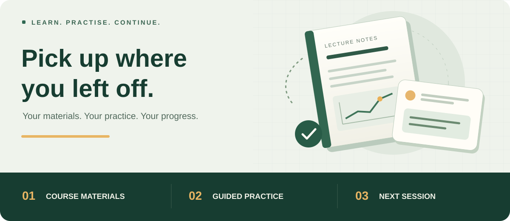

<strong>DeepSeek Harness edition</strong> · Windows 10/11 · Open source

<h1 align="center">Moodle Study Assistant</h1>

Turn your course materials into explanations, practice and a study record you can return to.

<strong>English</strong> · <a href="README.zh-CN.md">简体中文</a>

<a href="https://github.com/jiangzengyuang-jisoo/moodle-study-assistant/archive/refs/heads/deepseek.zip"><strong>Download DeepSeek Harness edition</strong></a> · <a href="https://raw.githubusercontent.com/jiangzengyuang-jisoo/moodle-study-assistant/refs/heads/deepseek/docs/tutorials/Moodle-Study-Assistant-Tutorial-English.pdf">Illustrated PDF guide</a> · <a href="https://github.com/jiangzengyuang-jisoo/moodle-study-assistant/tree/codex">Codex edition →</a>

## Your course. Your next step.

📖 **Learn from your own materials.** Read slides and handouts, follow your instructor’s methods, and trace explanations to source pages.

✍️ **Practise where you get stuck.** Start with an example, try a new problem, and use your actual answers to guide review.

↗ **Continue in another chat.** Keep your study position, mistakes and next step in the same workspace. Hearing an explanation is kept separate from independent mastery.

## Start in three steps

1. **Download & open.** Extract the `deepseek` ZIP into its own folder. Open the folder containing `AGENTS.md` in **DeepSeek Harness** as a local workspace.
2. **Ask for setup.** Paste the request below. Enter your school password only on the school’s sign-in page; choose your courses and sync mode in chat. Restart Harness when setup asks you to.
3. **Bring a chapter.** Choose full initialization to acquire accessible files for authorized courses, or add your own files to `Study/_Inbox/`. Then ask to learn a topic.

> Install this Moodle Study Assistant and show me how to use it. Read AGENTS.md first, preserve my existing records, help me connect my school and choose courses, then guide my first study session.

[Detailed setup](docs/新手使用指南.md) · [Chat onboarding](docs/CHAT_ONBOARDING.md) · [Upgrade without losing records](docs/新手使用指南.md#从旧版更新)

**Source edition:** this download is a Harness workspace, not an installable plugin. The frozen trial.8 package does not contain the latest source changes. [Plugin status](docs/market/CURRENT_CANDIDATE.md).

## Try one of these

> **Learn** — “Use my slides to explain this topic. Show the relevant pages, then let me try a new problem.”

> **Continue** — “Read my records and pick up where I stopped. Start with the point I struggled with.”

> **Plan** — “I have 90 minutes today. Check relevant deadlines and use my progress to plan the session.”

<strong>Before you connect · compatibility & privacy</strong>

- Requires your own AI client/account and a Moodle site with suitable API access. HKU is the default; other schools depend on their permissions. Browser login assistance is experimental.
- Materials and records stay in your local project and are excluded from normal Git commits. Content read by the assistant may reach its model provider: local storage is not offline inference.
- Moodle tools are read-only: no assignment submission, school quiz answers, posts or email. File downloads require your course authorization.
- Downloading and indexing are not content review; an explanation is not proof of mastery. Scans, formulas and model answers still need checking.

[Privacy](docs/PRIVACY.md) · [School connection help](docs/新手使用指南.md#连接失败或已有官方-token)

<strong>Recent updates · latest three</strong>

- [2026-11-17](docs/UPDATE_REPORT_2026-11-17-deepseek.en.md) · Latest source improvements and retained tutorials
- [2026-11-16](CHANGELOG.en.md#2026-11-16) · Chapter sync, recovery and scanned-page reading
- [2026-11-14](docs/UPDATE_TERMS_ALERTS_2026-11-14.md) · Bilingual terms and AI-instruction alerts

[Full changelog](CHANGELOG.en.md) · Validation details and limits are in each report.

---

[Material library](docs/LIBRARY.md) · [Teaching & practice](docs/TUTORING.md) · [Learning memory](docs/MEMORY.md) · [Exam preparation](docs/EXAM_PREP.md) · [Troubleshooting](docs/START.md) · [Report an issue](https://github.com/jiangzengyuang-jisoo/moodle-study-assistant/issues)

<a href="LICENSE">MIT License</a> · <a href="THIRD_PARTY_NOTICES.md">Third-party notices</a> · Community project; not officially affiliated with OpenAI, DeepSeek, HKU or Moodle. Most detailed guides are in Chinese.
