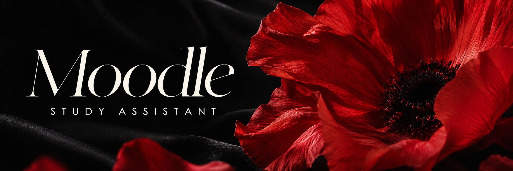

<p align="center"><strong>Codex 版</strong> · Windows 10/11 · 开源</p>



<h1 align="center">Moodle 学习助手</h1>
<p align="center">用你的课程资料讲解、练习，把每次学习的进度留下来。</p>
<p align="center"><a href="README.md">English</a> · <strong>简体中文</strong></p>
<p align="center"><a href="#复制给-ai开始安装"><strong>复制安装指令</strong></a> · <a href="https://raw.githubusercontent.com/jiangzengyuang-jisoo/moodle-study-assistant/refs/heads/codex/docs/tutorials/Moodle%E5%AD%A6%E4%B9%A0%E5%8A%A9%E6%89%8B%E6%95%99%E7%A8%8B.pdf">图文教程 PDF</a> · <a href="https://github.com/jiangzengyuang-jisoo/moodle-study-assistant/tree/deepseek">DeepSeek Harness 版 →</a></p>

## 复制给 AI，开始安装

把下面整段复制给能操作本机文件的 **Codex**，让它带你完成安装：

```text
帮我安装并配置这个 Moodle 学习助手（Codex 版）：
https://github.com/jiangzengyuang-jisoo/moodle-study-assistant/tree/codex

先读仓库里的安装说明，直接执行能完成的设置步骤，保留已有学习记录。
需要我登录、确认权限或选择课程时告诉我，完成后教我怎么用。
```

[图文安装指南](docs/新手使用指南.md) · [保留记录升级](docs/新手使用指南.md#从旧版更新)

## 围绕你的课，接着往下学

📖 **拿自己的课件学。** 读讲义、看原页，沿用老师的方法；讲到哪里，能找到对应资料。

✍️ **卡在哪里，就练哪里。** 先看必要示范，再独立做新题；用你的实际作答安排反馈和复习。

↗ **换个聊天，也能接上。** 在同一工作区保留进度、错题和下一步；讲过什么与独立掌握什么分别记录。

## 不知道怎么问？试试这三句

> **学知识**：「根据我的课件讲这个知识点，标出对应页码，再让我独立做一道新题。」

> **接着学**：「读取我的记录，从上次停下来的地方继续，先看那个卡点。」

> **排计划**：「今天有 90 分钟，核对相关截止日期，结合我的进度安排学习。」

<details>
<summary><strong>连接前了解 · 适用范围与隐私</strong></summary>

- 需要自己的 AI 客户端与账号，以及开放相应接口的 Moodle 学校。默认 HKU，其他学校取决于其权限；浏览器登录辅助仍属实验功能。
- 资料和记录保存在本地，正常 Git 提交排除个人数据。助手读取的内容可能发送给模型服务商，**本地保存不等于离线推理**。
- Moodle 工具只读，不提交作业、不答学校测验、不发帖或邮件；下载资料需要课程授权。
- 下载、索引不代表已核读，听过讲解不代表掌握；扫描页、公式和模型答案仍需核对。

[隐私说明](docs/PRIVACY.md) · [学校连接帮助](docs/新手使用指南.md#连接失败或已有官方-token)

</details>

## 最近更新

本章按来源时间同步，自动补齐已授权资料并支持失败恢复；扫描课件明确要求核读原页。821 项自动检查通过，升级方法与限制见[更新报告](docs/UPDATE_REPORT_2026-11-16.md)。

完整历史：[中文更新日志](CHANGELOG.md) · [English changelog](CHANGELOG.en.md)。

| 日期 | 更新内容 |
| --- | --- |
| [2026-11-16](docs/UPDATE_REPORT_2026-11-16.md) | 按章时间同步、授权下补齐、失败恢复与扫描原页阅读；821 项检查通过 |
| [2026-11-14](CHANGELOG.md#2026-11-14) | 新知识补齐中英术语对应；发现材料中的 AI 定向指令时先醒目提醒 |
| [2026-11-12](docs/UPDATE_REPORT_2026-11-12.md) | 同步教学保存与复习精简修复，跳过未变化页面；附验证依据和升级说明 |

离线测试不代表真实学校登录或所有安装环境已验证。具体检查和已知限制见[更新日志](CHANGELOG.md)。

---

[课程资料库](docs/LIBRARY.md) · [教学与练习](docs/TUTORING.md) · [学习记忆](docs/MEMORY.md) · [考试准备](docs/EXAM_PREP.md) · [排查问题](docs/START.md) · [反馈建议](https://github.com/jiangzengyuang-jisoo/moodle-study-assistant/issues)

<sub><a href="LICENSE">MIT 开源许可</a> · <a href="THIRD_PARTY_NOTICES.md">第三方组件</a> · 社区项目，与 OpenAI、DeepSeek、HKU、Moodle 无官方隶属关系。</sub>
