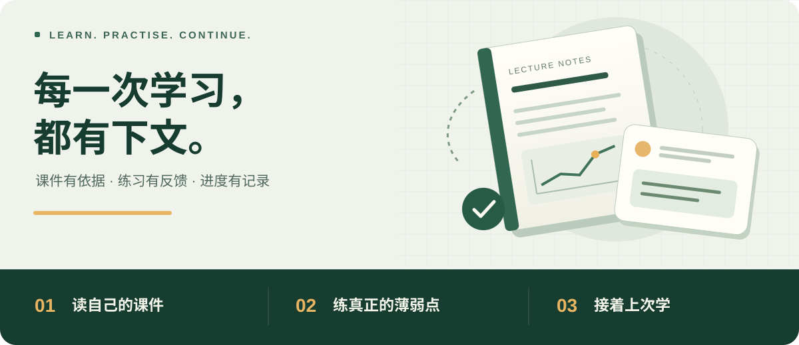

<strong>DeepSeek Harness 版</strong> · Windows 10/11 · 开源

<h1 align="center">Moodle 学习助手</h1>

用你的课程资料讲解、练习，把每次学习的进度留下来。

<a href="README.md">English</a> · <strong>简体中文</strong>

<a href="https://github.com/jiangzengyuang-jisoo/moodle-study-assistant/archive/refs/heads/deepseek.zip"><strong>下载 DeepSeek Harness 版</strong></a> · <a href="https://raw.githubusercontent.com/jiangzengyuang-jisoo/moodle-study-assistant/refs/heads/deepseek/docs/tutorials/Moodle%E5%AD%A6%E4%B9%A0%E5%8A%A9%E6%89%8B%E6%95%99%E7%A8%8B.pdf">图文教程 PDF</a> · <a href="https://github.com/jiangzengyuang-jisoo/moodle-study-assistant/tree/codex">Codex 版 →</a>

## 围绕你的课，接着往下学

📖 **拿自己的课件学。** 读讲义、看原页，沿用老师的方法；讲到哪里，能找到对应资料。

✍️ **卡在哪里，就练哪里。** 先看必要示范，再独立做新题；用你的实际作答安排反馈和复习。

↗ **换个聊天，也能接上。** 在同一工作区保留进度、错题和下一步；讲过什么与独立掌握什么分别记录。

## 三步开始

1. **下载并打开。** 将 `deepseek` 版 ZIP 解压到独立文件夹，在 **DeepSeek Harness** 中把含 `AGENTS.md` 的文件夹打开为本地工作区。
2. **让助手完成设置。** 复制下面这句话，在聊天中选课程和同步方式；学校密码由你在学校网页输入。设置提示重启时，完整重启 Harness。
3. **带着一章资料开始。** 选择“完整初始化”，获取已授权课程中可访问的资料；也可以把自有文件放进 `Study/_Inbox/`，再说想学什么。

> 帮我安装这个 Moodle 学习助手，并教我怎么用。先读 AGENTS.md，保留已有学习记录，带我连接学校、选择课程，再开始第一次学习。

[详细安装指南](docs/新手使用指南.md) · [聊天上手流程](docs/CHAT_ONBOARDING.md) · [保留记录升级](docs/新手使用指南.md#从旧版更新)

**这是源码版：** 下载后作为 Harness 工作区使用，并非可直接安装的插件包；冻结的 trial.8 包不包含最新源码改进。[查看插件状态](docs/market/CURRENT_CANDIDATE.md)。

## 不知道怎么问？试试这三句

> **学知识**：「根据我的课件讲这个知识点，标出对应页码，再让我独立做一道新题。」

> **接着学**：「读取我的记录，从上次停下来的地方继续，先看那个卡点。」

> **排计划**：「今天有 90 分钟，核对相关截止日期，结合我的进度安排学习。」

<strong>连接前了解 · 适用范围与隐私</strong>

- 需要自己的 AI 客户端与账号，以及开放相应接口的 Moodle 学校。默认 HKU，其他学校取决于其权限；浏览器登录辅助仍属实验功能。
- 资料和记录保存在本地，正常 Git 提交排除个人数据。助手读取的内容可能发送给模型服务商，**本地保存不等于离线推理**。
- Moodle 工具只读，不提交作业、不答学校测验、不发帖或邮件；下载资料需要课程授权。
- 下载、索引不代表已核读，听过讲解不代表掌握；扫描页、公式和模型答案仍需核对。

[隐私说明](docs/PRIVACY.md) · [学校连接帮助](docs/新手使用指南.md#连接失败或已有官方-token)

<strong>最近更新 · 三次功能更新</strong>

- [2026-11-17](docs/UPDATE_REPORT_2026-11-17-deepseek.md) · 最新源码改进与公开教程整合
- [2026-11-16](CHANGELOG.md#2026-11-16) · 按章同步、失败恢复与扫描原页阅读
- [2026-11-14](docs/UPDATE_TERMS_ALERTS_2026-11-14.md) · 中英术语对应与 AI 定向指令提醒

[完整更新日志](CHANGELOG.md) · 各报告保留验证结果与限制。

---

[课程资料库](docs/LIBRARY.md) · [教学与练习](docs/TUTORING.md) · [学习记忆](docs/MEMORY.md) · [考试准备](docs/EXAM_PREP.md) · [排查问题](docs/START.md) · [反馈建议](https://github.com/jiangzengyuang-jisoo/moodle-study-assistant/issues)

<a href="LICENSE">MIT 开源许可</a> · <a href="THIRD_PARTY_NOTICES.md">第三方组件</a> · 社区项目，与 OpenAI、DeepSeek、HKU、Moodle 无官方隶属关系。
